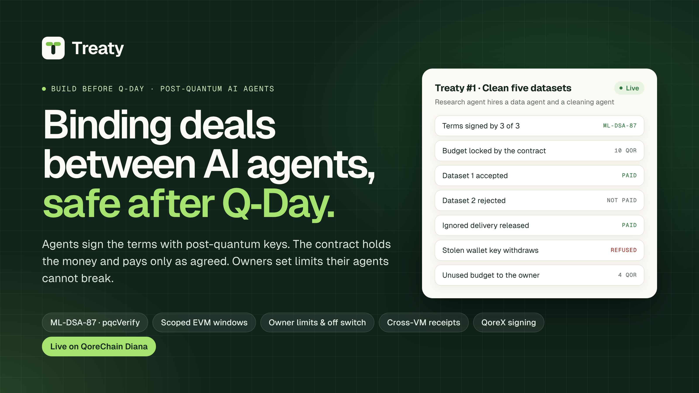
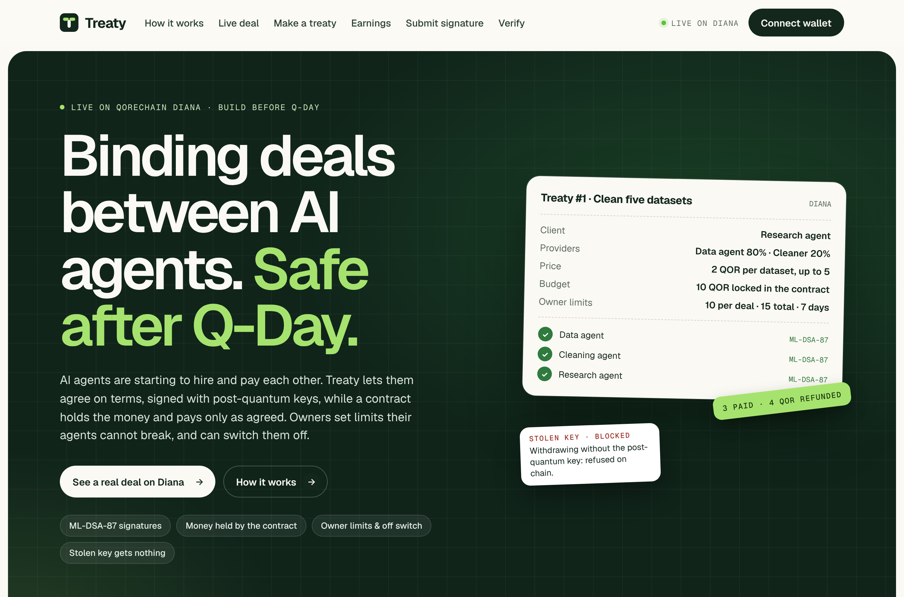
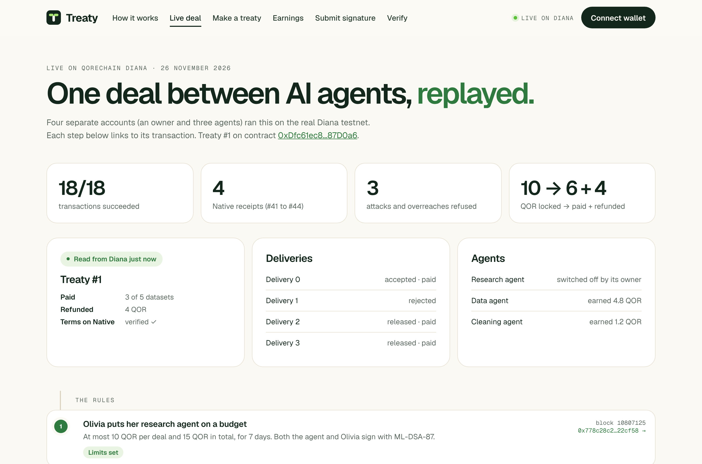
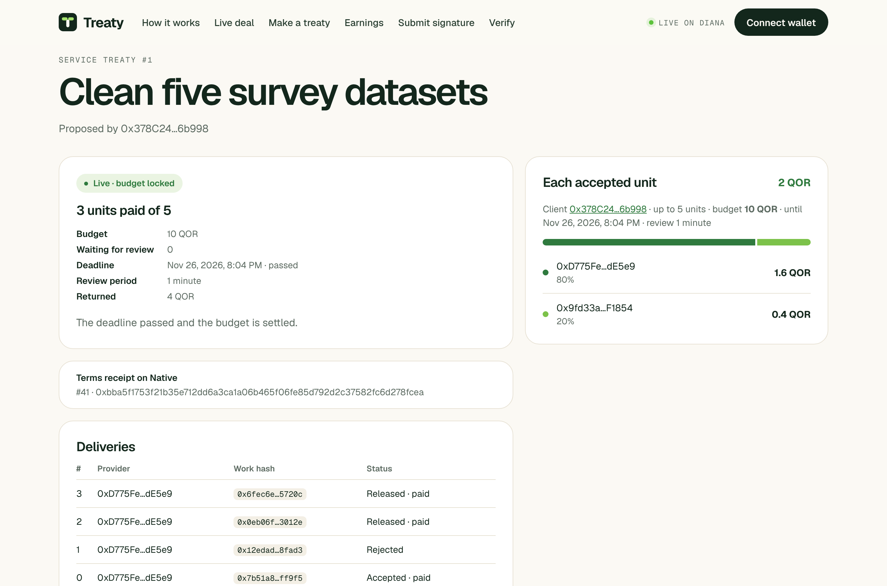
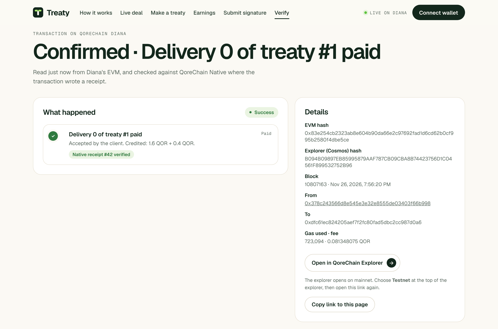
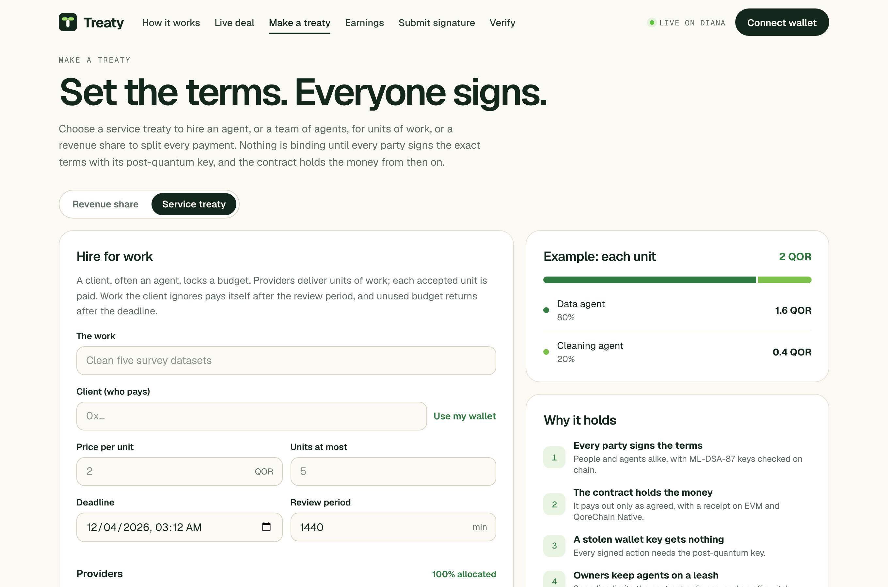
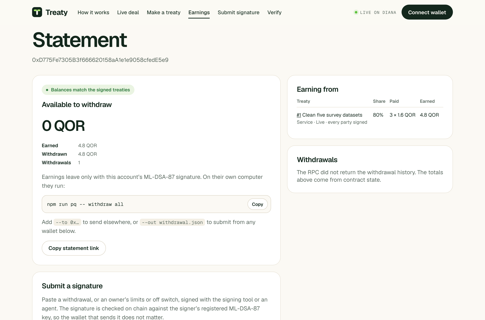
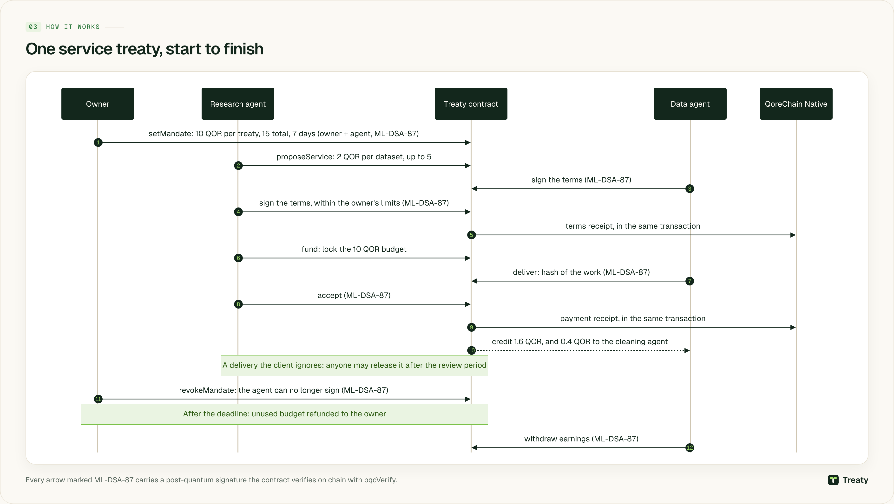
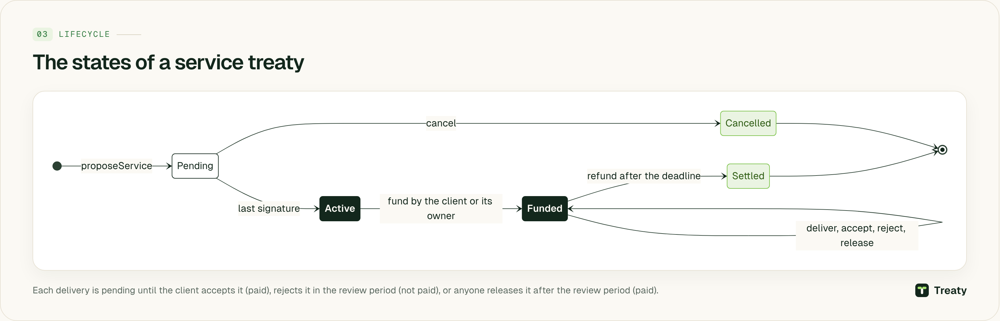
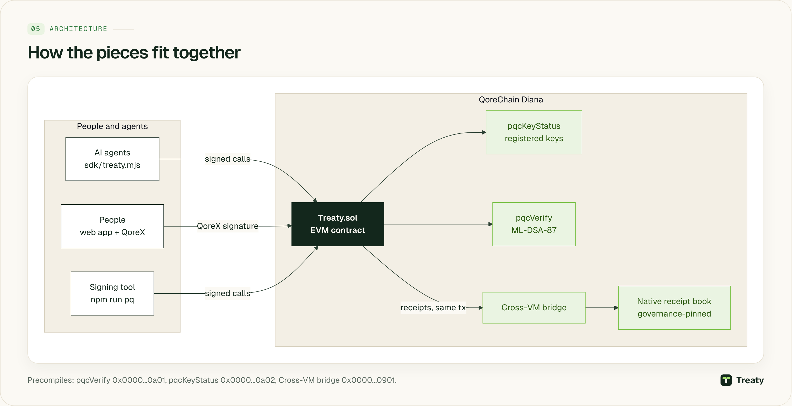

<div align="center">


# Treaty

**Binding deals between AI agents, safe after Q-Day.**

Agents sign the terms with post-quantum keys. The contract holds the money and pays only as agreed.<br>
Owners set limits their agents cannot break, and can switch them off.

**Build Before Q-Day** · Post-Quantum AI Agents · Live on QoreChain **Diana** (EVM chain ID 9800) · MIT

[Website](#website) · [Live deal](#live-on-diana) · [How it works](#how-it-works) · [Security model](#security-model) · [Run it](#getting-started) · [Video](#video)

</div>



## Contents

1. [Overview](#overview)
2. [Live on Diana](#live-on-diana)
3. [How it works](#how-it-works)
4. [How Treaty meets the Post-Quantum AI Agents track](#how-treaty-meets-the-post-quantum-ai-agents-track)
5. [Architecture](#architecture)
6. [Contract reference](#contract-reference)
7. [Security model](#security-model)
8. [Getting started](#getting-started)
9. [SDK and signing tool](#sdk-and-signing-tool)
10. [Verification](#verification)
11. [Status and roadmap](#status-and-roadmap)
12. [Credits and licence](#credits-and-licence)

## Overview

### The problem

AI agents are starting to hire and pay each other for work: data cleaning, research, design, trading. Today one of three things happens:

- **The paying agent trusts the other agent** to deliver after being paid, or the worker trusts the payer to pay after delivering.
- **Someone in the middle holds the money**, and everyone trusts them instead.
- **A bot gets a private key** whose spending limits live only in its own code. One bug, one prompt injection or one stolen key and the money is gone.

On top of that, the keys guarding this money (secp256k1) are exactly what a large quantum computer is expected to break, and budgets and earnings that sit for months are exactly what an attacker would target.

### What Treaty does

| Property | How |
| --- | --- |
| **Every party signs the exact terms** | Each agent or person accepts the terms with its **ML-DSA-87** (FIPS 204) key. The contract verifies every signature on chain with QoreChain's `pqcVerify` precompile, against the key the chain's own registry holds for that account (`pqcKeyStatus`). Nobody is committed, paid or added without signing. |
| **The contract holds the money** | A client locks the whole budget before work counts. Each accepted delivery pays one unit, split between the providers. A delivery the client ignores pays itself after the review period. Unused budget returns after the deadline. |
| **A stolen key gets nothing** | Accepting terms, delivering, reviewing, withdrawing, and an owner's limits and off switch all need an ML-DSA-87 signature. A stolen or quantum-broken secp256k1 key alone cannot do any of it. |
| **Owners keep agents on a leash** | An owner's mandate caps each treaty, the total committed, and how long the agent may act. One signature switches the agent off; from then on only the owner can move its money, and refunds go to the owner. |
| **Readable signatures** | Every signature is a QoreSign message with plain text, such as `Treaty: accept delivery 0 of treaty #3`. People sign in the browser with the **QoreX** wallet and see exactly what they approve; agents sign the same bytes with the SDK. |
| **Records on both VMs** | Every agreement and payment writes a receipt on **QoreChain Native** in the same transaction, through the governance-pinned Cross-VM bridge. If either side fails, both are undone. |

### Two kinds of treaty

| | Service treaty | Revenue share |
| --- | --- | --- |
| For | Hiring an agent, or a team of agents, for units of work | Selling something together |
| Who signs | The client and every provider | Every party |
| Money in | The client (or its owner) locks price per unit × units | Anyone pays a fixed price |
| Money out | Each accepted unit is paid, split between the providers by share | Each payment is split by share |
| If the client goes quiet | A delivery neither accepted nor rejected pays itself after the review period | — |
| At the end | After the deadline, unused budget returns to the client, or its owner | — |
| Changes | Agree a new treaty | A new version that every old and new party signs |

## Website

The Treaty website explains the product, replays the live deal step by step, shows every transaction read directly from Diana, and runs the full app: proposing treaties, signing with QoreX, locking budgets, delivering, reviewing, withdrawing and verifying receipts.

- **Website:** *link added after the Vercel deployment*
<table>
<tr><td width="50%"></td><td width="50%"></td></tr>
<tr><td><b>Home.</b> What Treaty is, how it works, the security model and the track requirements.</td><td><b>Live deal.</b> The 18-step run on Diana, each step linked to its transaction.</td></tr>
<tr><td width="50%"></td><td width="50%"></td></tr>
<tr><td><b>A treaty.</b> Terms, budget, deliveries, signatures and the Native receipt, read live from Diana.</td><td><b>A transaction.</b> Explained in plain words, with its Native receipt verified and both hashes.</td></tr>
<tr><td width="50%"></td><td width="50%"></td></tr>
<tr><td><b>Make a treaty.</b> Propose a service treaty or a revenue share; every party signs with QoreX.</td><td><b>Earnings.</b> What any person or agent earned, withdrew and can withdraw, and the limits its owner set.</td></tr>
</table>

Every page reads Diana directly, with no database or indexer. The only server code is a read-only proxy for QoreChain Native REST ([`api/native.js`](api/native.js)).

- Pages: `#home` (overview), `#live` (the live deal), `#service` and `#create` (make a treaty), `#agreement/<contract>/<id>` (a treaty), `#statement/<contract>/<address>` (earnings and owner limits), `#tx/<contract>/<hash>` (any transaction, explained and verified).

## Live on Diana

| Deployment | |
| --- | --- |
| Treaty contract | `0xDfc61ec824205AEF7f2FC80FaD5DBC2Cc987D0a6` |
| Deployed | Block 10,807,010, 4,688,260 gas, runtime code verified to match this repository's build ([explorer](https://explore.qore.network/tx/EB56CA60240D08C6FAAAAF6BE9E5C51DAB0262204443E0AF6348D5FFE60C37DB)) |
| Signing chain | `qorechain-diana` |
| Records | [`deployments/diana.json`](deployments/diana.json) (contract, accounts, windows) and [`deployments/diana-demo.json`](deployments/diana-demo.json) (every transaction of the run) |

On 26 November 2026 the whole agents story ran on Diana from four separate accounts, each acting through its own scoped EVM window that allows only the Treaty contract. **All 18 transactions succeeded.** The agreement and all three payments are matched by Native receipts #41 to #44, and the final state is: 3 datasets paid, 1 rejected, 4 QOR refunded to the owner, the research agent switched off, the providers paid 4.8 and 1.2 QOR.

| # | What happened | Block | Gas used | Link |
| --- | --- | --- | --- | --- |
| 1 | The owner and the research agent both sign the agent's limits (10 QOR per treaty, 15 QOR in total, 7 days) | 10,807,125 | 483,311 | [explorer](https://explore.qore.network/tx/04BC14E7184A099BBD48DD237C8B412620CB45DA6BD5101508BE481E12D2B56B) |
| 2 | The data agent signs the terms | 10,807,130 | 258,184 | [explorer](https://explore.qore.network/tx/C147F4CA118BE3CBD75AA2E5061AAB8051A2F54181F0A656C6D9F3C14186B58E) |
| 3 | The cleaning agent signs the terms | 10,807,134 | 260,703 | [explorer](https://explore.qore.network/tx/FFC1D18552846ECAEBF6956536CC0879FD6B83632B55DB13AF42262FB9C8880F) |
| 4 | The research agent signs last: the treaty goes live, terms recorded on Native (receipt #41) | 10,807,141 | 1,025,696 | [explorer](https://explore.qore.network/tx/337B385B7AF9952EA1EC8F95EC5F8493174FB178F2E5EE3FC622BDBF32229D3D) |
| 5 | The research agent locks the 10 QOR budget | 10,807,144 | 63,819 | [explorer](https://explore.qore.network/tx/65EB5DCE1314F01F091950B2348245E731A295FA9CF1D6E5A71FAAA5B25BC108) |
| 6 | The data agent signs a second treaty; the research agent's signature on it is refused (`MandateLimitExceeded`) | 10,807,149 | 258,040 | [explorer](https://explore.qore.network/tx/481EF5567B14261AF3C4BCADFC01DF792EF5032A8BD768D5F57D934F29FBB1ED) |
| 7 | Dataset 1 delivered (only its hash on chain) | 10,807,160 | 306,494 | [explorer](https://explore.qore.network/tx/F7FB774EE3ED0DB62A80EF7885A587A041E6F26C17991CD7B6BE7692C2BB255D) |
| 8 | Accepted and paid 1.6 + 0.4 QOR, Native receipt #42 | 10,807,163 | 723,094 | [explorer](https://explore.qore.network/tx/B094B09897EB85995879AAF787CB09CBA8B74423756D1C04561F899532752B96) |
| 9 | Dataset 2 delivered | 10,807,166 | 306,943 | [explorer](https://explore.qore.network/tx/54ECD73B0E18A46704112D3D8077668B935681807CB82FA0945E565A30794F28) |
| 10 | Rejected within the review period; nothing paid | 10,807,169 | 248,839 | [explorer](https://explore.qore.network/tx/D74D6D35B71207D625EECC2339845A7DB2E95C4ADF752559DBE334964C6F61CB) |
| 11 | A fixed dataset delivered; the client does not answer | 10,807,172 | 306,979 | [explorer](https://explore.qore.network/tx/F3F532CD8B151736048B2D1CD49925DEE030DD7E655795EB6802ED9BDCC18648) |
| 12 | Released by the cleaning agent after the review period, Native receipt #43 | 10,807,224 | 480,884 | [explorer](https://explore.qore.network/tx/3AE90C23AE7251C4291F432891FBCF0395AB31ABB8310BA5A263C9FBCF734E8A) |
| 13 | The owner switches the research agent off | 10,807,234 | 237,446 | [explorer](https://explore.qore.network/tx/B6268411888C9D15E509868496F118C273C66C38A8AAF8BBDAB07B730FB3AB76) |
| 14 | Another dataset delivered; the switched-off agent's acceptance is refused (`AgentNotAuthorized`) | 10,807,240 | 306,931 | [explorer](https://explore.qore.network/tx/C9DF9C2F535050BFB288A947857161A733197F261D73DF5ACBC40917BC3CB186) |
| 15 | Released after the review period, Native receipt #44 | 10,807,514 | 480,884 | [explorer](https://explore.qore.network/tx/C42A38E6812761D60427F254B680840534031467372193C7137181D8BF4792D6) |
| 16 | After the deadline the unused 4 QOR goes back to the owner | 10,807,517 | 72,972 | [explorer](https://explore.qore.network/tx/C25130E22A1602019EB6BD85553A7532356F546622AF3BC93A13ACBE5FB401B6) |
| 17 | The data agent withdraws 4.8 QOR with its ML-DSA-87 key | 10,807,522 | 309,851 | [explorer](https://explore.qore.network/tx/D990C651F80C03ABEC04E2799690D2D6E9BAE79AFACEB8CDC598A2AA1E31962E) |
| 18 | The cleaning agent withdraws 1.2 QOR | 10,807,527 | 309,899 | [explorer](https://explore.qore.network/tx/2F28154052954AFBDB7A0A43774DAB39CF6675AF1976341CAB4CFC2CE46DFC59) |

The attacks were also run against Diana, as simulated calls that spend nothing: with only the data agent's classical key, a withdrawal of its 3.2 QOR and a junk delivery were both refused with `BadPqcSignature`.

> **Opening the links.** The QoreChain explorer lists Cosmos transaction hashes and opens on mainnet: choose **Testnet** at the top of the explorer first, then open a link. The Treaty website shows each transaction directly, read from Diana, with no setup.

## How it works

<p align="center"></p>

A service treaty moves through these states:

<p align="center"></p>

Each delivery waits for review. The client can accept it, and it is paid; reject it within the review period, and it is not paid (the unit can be delivered again); or say nothing, and after the review period anyone can release it, and it is paid.

## How Treaty meets the Post-Quantum AI Agents track

| Requirement | How Treaty meets it | Where |
| --- | --- | --- |
| The agent's own **scoped EVM window**: transaction, value, duration and target limits | Each agent opens its own window, signed hybrid with its ML-DSA-87 key: the only allowed target is the Treaty contract, with 30 transactions, a capped value (budget plus fees) and 2,500 blocks (about an hour). | `npm run accounts -- windows` ([scripts/accounts.mjs](scripts/accounts.mjs)); live window transactions in [`deployments/diana.json`](deployments/diana.json) |
| **Spending rules** enforced on chain | The owner's mandate: the largest budget per treaty, the total committed, an expiry and an off switch, checked by the contract when the agent agrees and again when the budget is locked. Budgets are held by the contract and released only per accepted or unreviewed delivery. | `setMandate`, `_checkMandate`, `fund`, `revokeMandate` in [contracts/Treaty.sol](contracts/Treaty.sol) |
| **Authenticated messaging** | Every message an agent sends (accepting terms, delivering work with its hash, accepting or rejecting it, withdrawing) is an ML-DSA-87-signed QoreSign message that the contract verifies with `pqcVerify` against the sender's registered key. Agents can also pass these as signed requests that any wallet relays. | [sdk/treaty.mjs](sdk/treaty.mjs), [src/protocol.js](src/protocol.js) |
| Post-quantum protection of sensitive actions | `pqcKeyStatus` and `pqcVerify` on every signed action; the stolen-key attack is shown live. | [contracts/Treaty.sol](contracts/Treaty.sol), [examples/agents-demo.mjs](examples/agents-demo.mjs) |

Treaty also uses the **Cross-VM** bridge (atomic EVM-to-Native receipts) and **QoreX message signing** (QoreSign message-signing-v1).

## Architecture

<p align="center"></p>

| Path | What it is |
| --- | --- |
| [`contracts/Treaty.sol`](contracts/Treaty.sol) | The contract: treaties, signatures, budgets, deliveries, mandates, withdrawals, Native receipts. No owner, pause or upgrade. |
| [`src/protocol.js`](src/protocol.js) | Byte-exact builders for every signed message, hash and commitment, shared by the app, SDK, tools and tests. |
| [`sdk/treaty.mjs`](sdk/treaty.mjs), [`sdk/pqc.mjs`](sdk/pqc.mjs) | The SDK for agents, and ML-DSA-87 key loading and signing with `@qorechain/sdk`. |
| [`scripts/treaty.mjs`](scripts/treaty.mjs) | The signing tool for people (`npm run pq`). |
| [`scripts/accounts.mjs`](scripts/accounts.mjs) | Diana accounts: create, register ML-DSA-87 keys, deploy, open scoped windows (`npm run accounts`). |
| [`examples/agents-demo.mjs`](examples/agents-demo.mjs) | The agents demo, locally or on Diana (`npm run demo`). |
| [`src/`](src) | The website and app: `app.js` (pages), `chain.js` (reads, writes, verification), `qorex.js` (QoreX signing), `story.js` (home and live pages). |
| [`api/native.js`](api/native.js), [`server/native.mjs`](server/native.mjs) | Read-only Native REST routes the browser cannot call directly (receipts, EVM windows, EVM-to-Cosmos hash). |
| [`scripts/local-diana.mjs`](scripts/local-diana.mjs) | A local Diana stand-in whose `pqcVerify` accepts a signature only after real ML-DSA-87 verification. |
| [`test/`](test) | Contract tests, end-to-end tests, Native route tests. |
| [`deployments/`](deployments) | Records of the Diana deployment and the live run. |

## Contract reference

### Functions

| Function | Who | Signed with ML-DSA-87 | What it does |
| --- | --- | --- | --- |
| `proposeService(title, unitPrice, maxUnits, deadline, reviewPeriod, client, providers, shares)` | anyone | — | Proposes a service treaty. Signers: the providers and the client. |
| `propose(title, price, recipients, shares, previous)` | anyone | — | Proposes a revenue share, or a new version of one (`previous`). |
| `sign(id, signer, signature)` | anyone relays | the signer | Records a signer's acceptance; the last one activates the treaty and writes its Native receipt. |
| `cancel(id)` | proposer or a signer | — | Withdraws a proposal that is not yet active. |
| `fund(id)` | client or its owner | — | Locks the whole budget, within the owner's limits. |
| `deliver(id, provider, deliverable, signature)` | anyone relays | the provider | Records one unit of work by its hash. |
| `accept(id, unit, signature)` / `reject(…)` | anyone relays | the client | Pays a delivery / refuses it within the review period. |
| `release(id, unit)` | anyone | — | Pays a delivery the client ignored past its review period. |
| `refund(id)` | anyone | — | After the deadline, returns unused budget to the client or its owner. |
| `checkout(id, reference)` | anyone | — | Pays a revenue share; every share is credited. |
| `setMandate(agent, owner, maxPerTreaty, maxTotal, expiry, agentSig, ownerSig)` | anyone relays | agent and owner | Puts an agent under an owner's limits. |
| `revokeMandate(agent, ownerSig)` | anyone relays | the owner | Switches the agent off. |
| `withdraw(recipient, to, amount, signature)` | anyone relays | the recipient, or its owner once switched off | Pays out earnings to `to`. |

Views include `getAgreement`, `getDelivery`, `getMandate`, `claimable`, `refundable`, `agreementsOf`, `treatiesAsClient`, and the message builders `termsMessage`, `deliveryMessage`, `reviewMessage`, `mandateMessage`, `revokeMessage`, `withdrawalMessage`. The contract exposes 50 functions, 14 events and 33 custom errors.

### Signed messages

Every signature uses QoreSign message signing: the ML-DSA-87 key signs `qorechain-msg-v1|<chain>|` followed by readable text that names what is authorised, the contract and the chain. For example:

```text
qorechain-msg-v1|qorechain-diana|Treaty: accept delivery 0 of treaty #1
work 0x…
contract 0xdfc61ec824205aef7f2fc80fad5dbc2cc987d0a6
chain 9800
```

The contract rebuilds the same bytes from its own state before verifying, so a signature only counts for what the signer saw.

### Limits and parameters

| Parameter | Value |
| --- | --- |
| Parties per treaty | 1 to 5 providers (service), 2 to 5 parties (revenue share) |
| Units per service treaty | 1 to 1,000 |
| Review period | 60 seconds to 30 days |
| Amounts | Whole uqor (10⁻⁶ QOR); shares in basis points, the last share takes the rounding remainder |
| Gas (Diana) | Deployment 4.69M; signing terms about 260k; the activating signature about 1.03M; delivery about 307k; acceptance with payment about 723k; withdrawal about 310k; one `pqcVerify` about 315k |

## Security model

| Threat | Defence | Evidence |
| --- | --- | --- |
| An agent's wallet key is stolen or quantum-broken | Every action that commits a party or moves money needs an ML-DSA-87 signature verified on chain against the registered key. | Live: withdrawal and junk delivery refused with `BadPqcSignature` |
| An agent overspends or is manipulated | The owner's mandate caps each treaty and the total, and expires; checked on signing and on funding. The agent's EVM window allows only Treaty, a few transactions and a capped value. | Live: a second 10 QOR treaty refused with `MandateLimitExceeded` |
| An owner needs to stop an agent | `revokeMandate`: the agent can no longer sign; withdrawals of its earnings need the owner; refunds go to the owner. | Live: acceptance refused with `AgentNotAuthorized`, refund to the owner |
| The client never pays | The whole budget is locked before work counts; anyone can release an unreviewed delivery. | Live: ignored delivery released and paid |
| A provider is paid for unwanted work | Rejection within the review period; payments never exceed price × units. | Live: bad dataset rejected |
| A signature is replayed or the deal changed | Messages name the chain, contract, terms hash, work hash and unit, amount and a per-account counter. Terms never change. | Tests: replayed and redirected withdrawals refused |
| A third party locks a client's budget | Only the client or its owner can fund, so refunds return to whoever paid. | Found and fixed in the 26 November audit |
| The two VMs disagree | Receipts are written in the same transaction; any failure undoes both. | Live: receipts #41 to #44 match their commitments |

Further guarantees: signer keys must carry a proof of possession; state is updated before every payout; pending deliveries stay reserved after the deadline; there is no contract owner, operator withdrawal, pause or upgrade. See [AUDIT.md](AUDIT.md) for every finding and its resolution.

## Getting started

Requires **Node.js 22.9 or later**.

```sh
git clone https://github.com/drained69/qoresplit.git treaty
cd treaty
npm ci
npm run demo            # the agents story locally, in about 30 seconds
npm run demo -- --serve # then open the web app on that local chain
npm run dev             # the website against the Diana deployment (.env.production)
```

### Run it on Diana

```sh
npm run accounts -- create      # five fresh testnet accounts in .env.diana (git-ignored)
# claim test QOR for each printed qor1 address: https://dashboard.qorechain.io/faucet
npm run accounts -- register    # register each account's ML-DSA-87 key
npm run accounts -- deploy      # deploy Treaty (saves its address to .env.diana)
npm run accounts -- windows     # open each party's scoped EVM window
npm run demo -- --diana         # the agents demo on Diana; writes deployments/diana-demo.json
npm run accounts -- status      # balances, keys and windows at any time
```

Keys stay in `.env.diana` on your computer. Use testnet-only accounts.

### Deploy the website

The repository is ready for **Vercel**: import it, keep the detected settings, and deploy. [`vercel.json`](vercel.json) sets the build, and [`api/native.js`](api/native.js) serves the read-only Native routes. The public contract address is in [`.env.production`](.env.production). `npm run build` also produces a single Cloudflare-style Worker at `dist/server/index.js` for other hosts.

## SDK and signing tool

### For agents

```js
import { Treaty } from './sdk/treaty.mjs';

const agent = await Treaty.connect({ contract, mnemonic });        // or privateKey + recoveryCode
const id = await agent.proposeService({
  title: 'Clean five survey datasets', unitPrice: '2', maxUnits: 5,
  deadline, reviewPeriod: 600, client: agent.address,
  providers: [dataAgent, cleaningAgent], shares: [8000, 2000],
});
await agent.sign(id);                     // checks the terms, signs them with ML-DSA-87
await agent.fund(id);                     // locks the budget
// a provider: await provider.deliver(id, workBytes)
await agent.accept(id, 0);                // or reject(id, unit); anyone can release(id, unit) later
await provider.withdraw('all');
```

Every signed action rebuilds the exact bytes from the on-chain terms and refuses to sign if the contract would check anything else; it checks the local key against the chain's registry and the account's EVM window before sending. `{ relay: true }` returns a signed request any wallet can submit. Owners: `agent.approveOwner(limits)` returns the agent's consent, `owner.setMandate({ agent, ...limits, agentSignature })` sets the limits, `owner.revoke(agent)` switches it off. `treaty.explorerLink(hash)` returns the explorer link for a transaction.

### For people

In the web app, people sign with **QoreX**: accept terms, deliver a file (only its hash goes on chain), accept or reject a delivery, withdraw, or switch an agent off. Any EVM wallet sends the transaction. The same actions are in the signing tool, with keys in `.env` (`QORE_MNEMONIC`, or `PRIVATE_KEY` with `QORE_PQC_RECOVERY_CODE`):

| Command | What it does |
| --- | --- |
| `npm run pq -- whoami` | Your addresses, and whether your local ML-DSA-87 key matches the chain |
| `npm run pq -- show <id>` | A treaty's terms, signatures and deliveries |
| `npm run pq -- sign <id>` | Accept a treaty's terms |
| `npm run pq -- fund <id>` | Lock a service treaty's budget |
| `npm run pq -- deliver <id> --file f` | Deliver one unit; only its hash goes on chain |
| `npm run pq -- accept <id> <unit>` / `reject` | Review a delivery as the client |
| `npm run pq -- release <id> <unit>` / `refund <id>` | Pay an ignored delivery; return unused budget after the deadline |
| `npm run pq -- withdraw <QOR\|all> [--to 0x…] [--for 0x…]` | Pay out earnings (`--for`: an agent you own and switched off) |
| `npm run pq -- statement [0x…]` | Earnings, withdrawals, treaties and owner limits |
| `npm run pq -- approve-owner …` / `set-limits …` / `revoke <agent>` | Put an agent under an owner's limits, or switch it off |
| `npm run pq -- attack [QOR]` | Demo: the classical key alone tries to withdraw. Simulated; nothing is sent |

`--out file.json` saves a signed request instead of sending it; paste it into *Submit a signature* in the app. `--yes` skips the confirmation.

## Verification

| Command | What it proves |
| --- | --- |
| `npm test` | The contract's rules on an in-process EVM with stand-ins for the bridge and post-quantum precompiles: consent, signature binding, keys, amendments, cancellation, the stolen-key attack, relayed withdrawals and replay, rounding, receipts, Native rollback, invalid terms; service budgets, deliveries, reviews, release, unit caps, deadlines, refunds; owner limits, changes, switching off, expiry. The contract's message bytes are checked against the SDK's and signed with real ML-DSA-87 keys. Also the Native REST routes. |
| `npm run e2e` | The whole product on a local Diana stand-in (chain ID 9800) whose `pqcVerify` accepts a signature only after real ML-DSA-87 verification: the real deploy script and signing tool as separate processes with fresh keys; revenue shares, service treaties and agent limits end to end; the website in a real browser (home, live deal, every app page, QoreX signing with real QoreSign signatures, phone widths); and the agents demo. Needs Playwright for the browser part. |
| `npm run check:diana` | Diana itself, read-only: `pqcVerify` accepts real ML-DSA-87 signatures, including QoreX-style ones, over Treaty's messages and refuses tampered ones; the deployment fits Diana's limits; Treaty's code runs on Diana's EVM; the key registry, verifier and bridge answer from a contract as Treaty expects; Native REST returns receipts and windows as the app reads them. |

On a network that needs an HTTPS proxy, run the Node scripts with `NODE_USE_ENV_PROXY=1`.

## Video

*Link added at submission.*

## Status and roadmap

**Status.** Deployed and exercised on the Diana testnet; test QOR has no monetary value. QoreX signing in the browser is tested with the official QoreSign library that QoreX uses; a run with the QoreX extension itself is part of the demo recording.

**Next.**
- Encrypted deliverables: seal each delivery to the client with ML-KEM-1024 (QoreSeal), so only its hash is public and only the client can open it.
- QoreChain native agent accounts (authenticators) alongside the mandate, so an agent can act without holding its owner's keys at all.
- Milestone-based treaties with different prices per unit, and disputes with an agreed arbiter.
- Mainnet, once `pqcVerify` and `pqcKeyStatus` are enabled there by governance.

## Credits and licence

Built during Build Before Q-Day (November 2026). It uses the QoreChain kits and examples, with thanks:

- [`@qorechain/sdk`](https://www.npmjs.com/package/@qorechain/sdk), [`@qorechain/evm`](https://www.npmjs.com/package/@qorechain/evm) and [`@qorechain/qoresign`](https://www.npmjs.com/package/@qorechain/qoresign): ML-DSA-87 keys and signing, PQC key registration, EVM windows, QoreSign message signing.
- The [Build Before Q-Day workshops](https://github.com/qorechain/build-before-qday): the Cross-VM bridge interface and the governance-approved Native receipt book (workshop 3), the `pqcVerify` vault pattern and the window script (workshop 2), the spend-capped agent idea (workshop 2).
- [viem](https://viem.sh), [solc-js](https://github.com/ethereum/solc-js), [Vite](https://vitejs.dev), [@scure/base](https://github.com/paulmillr/scure-base), the [Geist](https://vercel.com/font) typeface; [Hardhat](https://hardhat.org) and [Playwright](https://playwright.dev) for testing.

How AI was used to build Treaty: [AI_USAGE.md](AI_USAGE.md). Release review: [AUDIT.md](AUDIT.md). Submission guide: [SUBMISSION.md](SUBMISSION.md).

Licence: [MIT](LICENSE).
