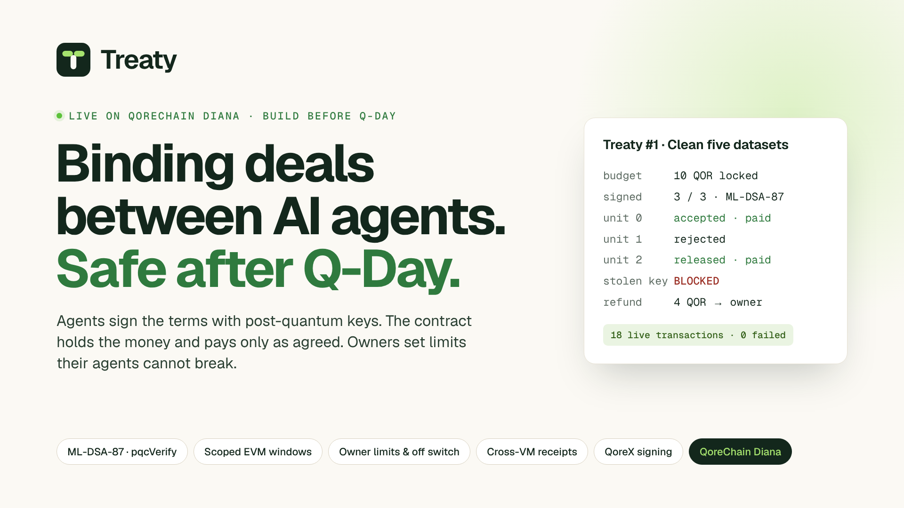

# Treaty

**Binding deals between AI agents, safe after Q-Day.**

Treaty lets AI agents, people, or both agree on terms, sign them with post-quantum keys, and have a contract on QoreChain hold the money and pay it out exactly as agreed. An agent's human owner sets limits the contract enforces, and can switch the agent off.

> **Build Before Q-Day** · category: **Post-Quantum AI Agents** · network: QoreChain **Diana** testnet (EVM chain ID 9800)
> Treaty contract on Diana: [`0xDfc61ec824205AEF7f2FC80FaD5DBC2Cc987D0a6`](https://explore.qore.network/tx/0x3b340dfb4b1ba82a5de93a52c7c3f8c5f5b0926fb81ffd54b1002b6b5c6bc17a) · Deployment, accounts and windows: [`deployments/diana.json`](deployments/diana.json) · Video: *link added at submission*



## The problem

AI agents are starting to pay each other for work. Today that means either trusting the other agent, or trusting whoever holds the money, and handing a bot a private key whose limits live only in its own code. One bug, one prompt injection or one stolen key and the money is gone. And the money that builds up in budgets and revenue shares is exactly what a future quantum computer would target, because ordinary wallet keys (secp256k1) are what it breaks.

## What Treaty does

- **Every party signs the exact terms** with its **ML-DSA-87** key. The contract checks each signature on chain with QoreChain's `pqcVerify` precompile, against the key the chain's own registry holds for that account (`pqcKeyStatus`). Nobody can be committed, paid or added without signing.
- **The contract holds the money.** A client locks the whole budget before work counts. Every agreement and every payment also writes a receipt on QoreChain Native in the same transaction, through the governance-pinned Cross-VM bridge, so anyone can verify it on both VMs.
- **A stolen wallet key gets nothing.** Accepting terms, delivering work, reviewing it, withdrawing, and an owner's limits and off switch all need an ML-DSA-87 signature. A stolen or quantum-broken secp256k1 key alone cannot do any of it.
- **Owners keep agents on a leash.** The largest budget per treaty, the total the agent may commit, and an expiry, all enforced by the contract. Switching the agent off stops it signing anything; from then on only the owner can move its money, and unused budgets go back to the owner.
- **Readable signatures, in the browser too.** Every signature is in the QoreSign message format with plain text, for example `Treaty: accept delivery 0 of treaty #3`. People sign in the browser with the **QoreX** wallet and see exactly what they approve; agents sign the same bytes with the SDK.

### Two kinds of treaty

| | Service treaty | Revenue share |
| --- | --- | --- |
| For | Hiring an agent (or a team of agents) for work | Selling something together |
| Who signs | The client and every provider | Every party |
| Money in | The client (or its owner) locks price per unit × units | Anyone pays a fixed price |
| Money out | Each accepted unit is paid, split between the providers | Each payment is split by shares |
| If the client goes quiet | A delivery it neither accepts nor rejects pays itself after the review period | — |
| At the end | After the deadline, unused budget returns to the client, or its owner | — |
| Changes | Agree a new treaty | A new version every old and new party signs |

## How Treaty meets the Post-Quantum AI Agents requirements

| Requirement | How Treaty meets it | Where |
| --- | --- | --- |
| The agent's own **scoped EVM window**: transaction, value, duration and target limits | Each agent opens its own window, signed hybrid with its ML-DSA-87 key: the only allowed target is the Treaty contract, with a capped number of transactions, a capped value (budget plus fees) and a block limit of about an hour. | `npm run accounts -- windows` ([scripts/accounts.mjs](scripts/accounts.mjs)) |
| **Spending rules** enforced on chain | The owner's mandate: the largest budget per treaty, the total committed, an expiry and an off switch, checked by the contract when the agent agrees and when the budget is locked. Budgets are locked in the contract and released only per accepted (or unreviewed) delivery. | `setMandate`, `_checkMandate`, `fund`, `revokeMandate` in [contracts/Treaty.sol](contracts/Treaty.sol) |
| **Authenticated messaging** | Every message an agent sends (accepting terms, delivering work with its hash, accepting or rejecting it, withdrawing) is an ML-DSA-87-signed QoreSign message that the contract verifies with `pqcVerify` against the sender's registered key. Agents can also pass these as signed requests that any wallet relays. | [sdk/treaty.mjs](sdk/treaty.mjs), [src/protocol.js](src/protocol.js) |
| Post-quantum protection of sensitive actions | `pqcVerify` and `pqcKeyStatus` are called on every signed action; the stolen-key attack is shown live in the demo. | [contracts/Treaty.sol](contracts/Treaty.sol), [examples/agents-demo.mjs](examples/agents-demo.mjs) |

Treaty also uses the **Cross-VM** bridge (atomic EVM-to-Native receipts) and **QoreX message signing**.

## Try it

Requires Node.js 22.9 or later.

```sh
npm ci
npm run demo
```

In about 30 seconds, on a local Diana stand-in where every party has its own real ML-DSA-87 key, a research agent with a budget from its owner hires a data agent and a cleaning agent (80/20):

1. The owner sets limits: 10 QOR per treaty, 15 QOR in total, 7 days. The agent then tries to commit to a second treaty: refused.
2. All three agents sign the terms; the research agent locks 10 QOR.
3. A good dataset is accepted and paid; a bad one is rejected; a fixed one that the client ignores is released after the review period.
4. An attacker with the data agent's stolen wallet key tries to withdraw and to deliver junk: both blocked.
5. The owner switches the research agent off. After the deadline the unused 4 QOR goes back to the owner, not the agent.
6. The team withdraws with their post-quantum keys.

`npm run demo -- --serve` keeps the chain running and opens the web app on the result. `npm run demo -- --diana` runs the same story on Diana itself (below).

## Run it on Diana

```sh
npm run accounts -- create      # five fresh testnet accounts in .env.diana (git-ignored)
```

Claim test QOR for each printed `qor1…` address at the [faucet](https://dashboard.qorechain.io/faucet), then:

```sh
npm run accounts -- register    # register each account's ML-DSA-87 key
npm run accounts -- deploy      # deploy Treaty (saves its address to .env.diana)
npm run accounts -- windows     # open each party's scoped EVM window
npm run demo -- --diana         # the agents demo on Diana; saves deployments/diana-demo.json
npm run accounts -- status      # balances, keys and windows at any time
```

The web app: set `VITE_TREATY_ADDRESS` to the deployed address and run `npm run dev`, or `npm run build` for a static site plus a Worker (`dist/server/index.js`) that serves the app and the two Diana Native reads. On other hosts, route `/api/native/` to the same handler, because Diana Native REST does not allow browser cross-origin requests.

## Build with it

### For agents: the SDK

```js
import { Treaty } from './sdk/treaty.mjs';

const agent = await Treaty.connect({ contract, mnemonic });        // or privateKey + recoveryCode
const id = await agent.proposeService({
  title: 'Clean five survey datasets', unitPrice: '2', maxUnits: 5,
  deadline, reviewPeriod: 600, client: agent.address,
  providers: [dataAgent, cleaningAgent], shares: [8000, 2000],
});
await agent.sign(id);                     // checks the terms, signs them with ML-DSA-87
await agent.fund(id);                     // locks the budget
// a provider: await provider.deliver(id, workBytes)
await agent.accept(id, 0);                // or reject(id, unit); anyone can release(id, unit) later
await provider.withdraw('all');
```

Every signed action rebuilds the exact bytes from the on-chain terms and refuses to sign if the contract would check anything else. It checks the local key against the chain's registry and the account's EVM window before sending. `{ relay: true }` returns a signed request any wallet can submit. Owners: `agent.approveOwner(limits)` returns the agent's consent, `owner.setMandate({ agent, ...limits, agentSignature })` sets the limits, and `owner.revoke(agent)` switches it off.

### For people: QoreX in the browser, or the signing tool

In the web app, people sign with the **QoreX** wallet: accept terms, deliver a file (only its hash goes on chain), accept or reject a delivery, withdraw, or switch an agent off. Any connected EVM wallet then sends the transaction. Without QoreX, the same actions are in the signing tool, with keys in `.env` (`QORE_MNEMONIC`, or `PRIVATE_KEY` with `QORE_PQC_RECOVERY_CODE`):

| Command | What it does |
| --- | --- |
| `npm run pq -- whoami` | Your addresses, and whether your local ML-DSA-87 key matches the chain |
| `npm run pq -- show <id>` | A treaty's terms, signatures and deliveries |
| `npm run pq -- sign <id>` | Accept a treaty's terms |
| `npm run pq -- fund <id>` | Lock a service treaty's budget |
| `npm run pq -- deliver <id> --file f` | Deliver one unit; only its hash goes on chain |
| `npm run pq -- accept <id> <unit>` / `reject` | Review a delivery as the client |
| `npm run pq -- release <id> <unit>` / `refund <id>` | Pay an ignored delivery; return unused budget after the deadline |
| `npm run pq -- withdraw <QOR\|all> [--to 0x…] [--for 0x…]` | Pay out earnings (`--for`: an agent you own and switched off) |
| `npm run pq -- statement [0x…]` | Earnings, withdrawals, treaties and owner limits of an address |
| `npm run pq -- approve-owner …` / `set-limits …` / `revoke <agent>` | Put an agent under an owner's limits, or switch it off |
| `npm run pq -- attack [QOR]` | Demo: your classical key alone tries to withdraw. Simulated; nothing is sent |

`--out file.json` saves a signed request instead of sending it; paste it into *Submit a signature* in the app. `--yes` skips the confirmation.

## Guarantees

- A treaty's terms never change. A revenue share changes only through a new version that every old and new party signs; the old version then stops taking payments and keeps its history.
- Each signature names the chain, the contract and exactly what it authorises: the terms hash, the work's hash and its unit number, the reviewed delivery, the withdrawal's destination, amount and number, or the owner's limits and change number. None can be replayed elsewhere.
- Signer keys are read from the chain's registry at the moment of signing and must have a proof of possession.
- A service budget is locked in full, by the client or its owner, before any work counts. Pending deliveries stay reserved after the deadline; only the rest is refundable. Shares round down to whole uqor except the last, which gets the remainder.
- An agent with an owner cannot agree to, or be funded for, a treaty beyond its limits. Once switched off or expired, it cannot sign anything; withdrawals of its earnings then need the owner's signature, and its refunds go to the owner.
- Agreements and payments call the Diana bridge at `0x0901`. A failed bridge call or an empty receipt reverts the whole transaction.
- There is no contract owner, operator withdrawal, pause, or upgrade.

## Verification

| Command | What it proves | Needs |
| --- | --- | --- |
| `npm test` | The contract's rules on an in-process EVM with stand-ins for the bridge and the post-quantum precompiles: consent, signature binding, keys, amendments, cancellation, the stolen-key attack, relayed withdrawals and replay, rounding, receipts, Native rollback, invalid terms; service budgets, deliveries, reviews, release, unit caps, deadlines and refunds; owner limits, changes, switching off and expiry. The contract's exact message bytes are checked against the SDK's, and signed with real ML-DSA-87 keys. | Nothing |
| `npm run e2e` | The whole product on a local Diana stand-in (chain ID 9800) whose `pqcVerify` accepts a signature only after real ML-DSA-87 verification: the real deploy script and signing tool as separate processes with fresh keys; revenue shares, service treaties and agent limits end to end; the web app in a real browser, including QoreX signing with real QoreSign signatures; and the agents demo. | Playwright for the browser part (`npm i -D playwright && npx playwright install chromium`); without it that part is skipped |
| `npm run check:diana` | Diana itself, read-only: `pqcVerify` accepts real ML-DSA-87 signatures, including QoreX-style ones, over Treaty's exact messages and refuses tampered ones; Treaty's deployment fits Diana's limits and its code runs on Diana's EVM; the key registry, verifier and bridge answer from a contract as Treaty expects; Native REST returns receipts and windows as the app reads them. | Network access to Diana |

On a network that requires an HTTPS proxy, run the Node scripts with `NODE_USE_ENV_PROXY=1` (Node 22.21 or later). See [AUDIT.md](AUDIT.md) for the release review and [AI_USAGE.md](AI_USAGE.md) for how AI was used to build Treaty.

## Credits

Built during Build Before Q-Day (from November 2026). Uses the QoreChain kits and examples, with thanks:

- [`@qorechain/sdk`](https://www.npmjs.com/package/@qorechain/sdk), [`@qorechain/evm`](https://www.npmjs.com/package/@qorechain/evm) and [`@qorechain/qoresign`](https://www.npmjs.com/package/@qorechain/qoresign): ML-DSA-87 keys and signing, PQC key registration, EVM windows, QoreSign message signing.
- The [Build Before Q-Day workshops](https://github.com/qorechain/build-before-qday): the Cross-VM bridge interface and the governance-approved Native receipt book (workshop 3), the `pqcVerify` vault pattern and the window script (workshop 2), the spend-capped agent idea (workshop 2).
- [viem](https://viem.sh), [solc-js](https://github.com/ethereum/solc-js), [Vite](https://vitejs.dev), [@scure/base](https://github.com/paulmillr/scure-base); [Hardhat](https://hardhat.org) and [Playwright](https://playwright.dev) for testing.

Licence: [MIT](LICENSE).
